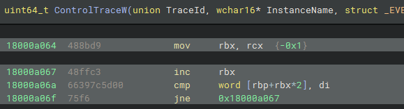
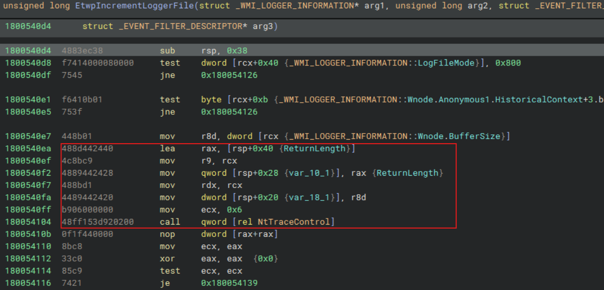
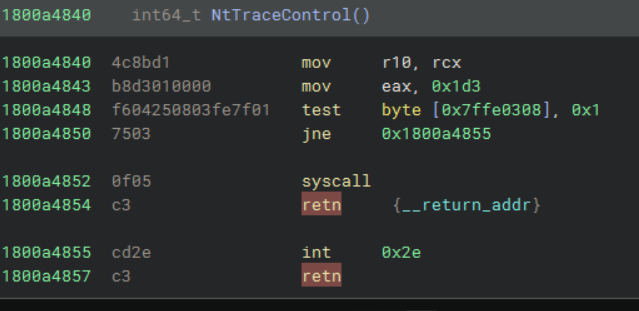
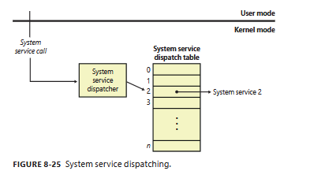
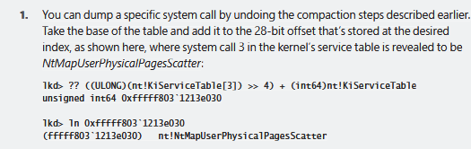
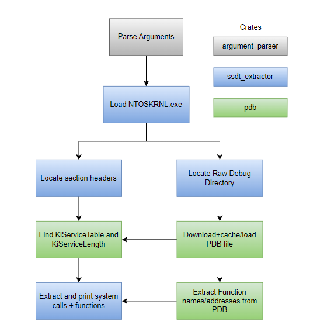
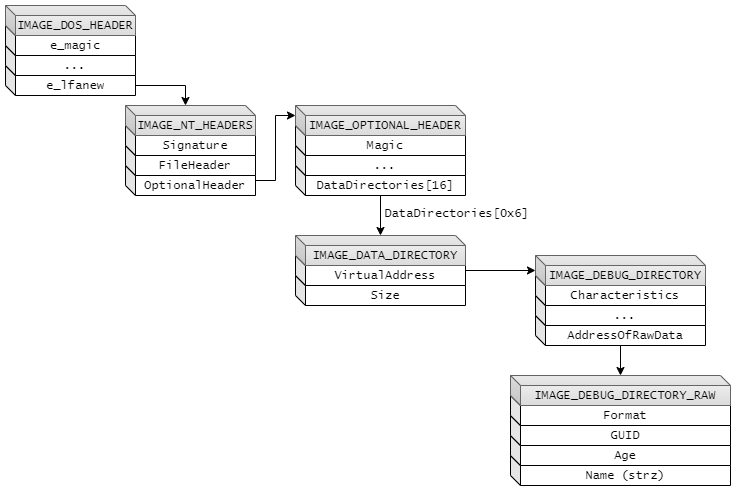
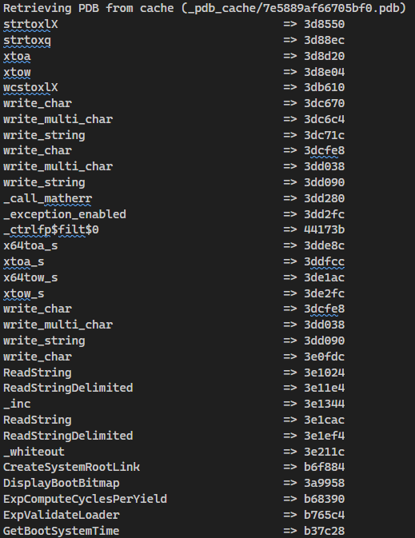
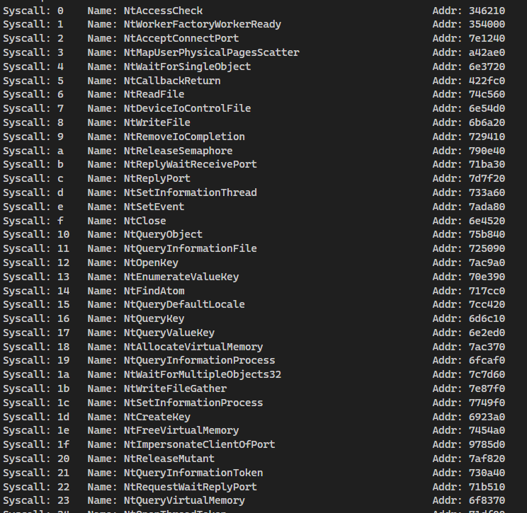

+++
date = '2026-11-03T14:33:57-05:00'
draft = false
title = 'Windows System Call Function Extraction'
+++

### Table of Contents
1. Introduction
2. Finding the System Call Table
3. Outline of the Rust Program
4. Parsing the Kernel Image

### Introduction
I was recently poking around Windows ETW libraries; I had found a mysterious bug in my program that manifested itself within a function exported by `sechost.dll`—`ControlTraceW`. I passed a random integer instead of a valid pointer, and because the pointer was being casted via `reinterpret_cast`, and it was a semi-valid conversion, the compiler, without all warnings on, didn't bother to mention it. So after some reverse engineering I found out that the parameter `ControlTraceW` was expecting was a `LPWSTR`; the program crashed within the function when it tried to determine the length of this. At first I was wondering whether this was an actual, critical security issue, but through research I found that `ControlTraceW` and `sechost.dll` are operating in the process's memory space, not kernel space. So while it is extremely dubious, it is not a "real" security issue, per se. 


*`InstanceName` is the parameter I did not set correctly; being referenced via `rbp` (`rbx` is a length counter), this fails at `18000a06a` if the integer does not point to a valid memory address*

But I decided to poke around further to see what exactly `ControlTraceW` was doing. Its parameters include a `ControlCode` (`ULONG`), which appears to be routed via a switch statement (I hope) to an internal function, marked with the `Etwp` namespace, that is, "Event Tracing for Windows private". Each of those functions that are called by `ControlTraceW` generally make a call to `NtTraceControl`...but what is this? 



This is an imported function from `NTDLL.DLL`, where many such functions live. Those functions tend to look like this:

<center><i><code>ntdll!NtTraceControl</code></i></center>

These functions are wrappers around system calls, much like function such as `execve` in Linux. The system call number is set via the `eax` register (addr `1800a4843`) before trapping into the kernel (addr `1800a4854`). These functions have such little variation it is possible to extract system call numbers from the function’s instructions and then call them manually, perhaps to evade outdated AV/EDR programs.

But this led me to wonder how Windows handles this internally. How does it know that `0x1d3` maps to an internal version of `NtTraceControl`? My hypothesis was that it is an array like any other, a hypothesis that turned out to be correct.

The rest of this article will cover how this array was identified and parsed. While my instinct was to write this in C++, I decided that, since I was already venturing into unknown territory, I could make it easier for myself by using a language I have never used at scale before: Rust. Thus, this article will cover the reverse engineering of the system call table and my first experiences using Rust.

### Finding the System Call Table
The first step I took was to crack open Windows Internals Part II and flip to Chapter 8. I found here a lot of detail about system calls that I won’t explore here, but will absolutely be the subject of a future article. 

In this diagram, we can see the general flow of a system call; the "System Service Dispatch Table" is what I am looking for:



Fortunately there is a section in this chapter that tells you *exactly* what this table is and how to parse it:



So now all that is left for us to do are the following:
- Load the kernel file---I am doing everything statically, so the Rust program will essentially be an automated reverse engineering tool
- Parse the file
- Load the PDB---this is where most of development issues arose
- Locate and parse `KiServiceTable` and `KiServiceLimit`
    - `KiServiceLimit` was not mentioned anywhere, but in memory, it is located just after `KiServiceTable`. Doing some math, I found it coincidentally was equal to the number of 32 bit integers in `KiServiceTable`
- Associate functions within the PDB with functions found in `KiServiceTable`
- Print out a nice table

### Outline of the Rust Program
Having never written anything substantial (only about half a M6502 emulator) in Rust, I had some trouble to start with, but not nearly as much as I was expecting. The first hurdle was perhaps the wrong thing to start with, but given my lack of familiarity, I decided to start with a limited clone of POSIX's `getopt` function. 



Originally, the only thirdparty library I was going to use was `reqwest`, but I decided to use `zerocopy` for a more idiomatic approach for binary deserialization. And after stumbling into whatever circle of hell Microsoft documentation resides, I decided to use their `pdb-rs` library.

### Parsing the PE File
The primary two issues with parsing PE files in my experience have been the following:
- Checking sizes/offsets; e.g. making sure the `VirtualAddress` of the `.idata` section resides within the file
- Binary deserialization

Using what is probably my favorite feature of Rust, I solved the former issue. The code that specifically deals with PE parsing and extracting the SSDT is called `ssdt_extractor`. It looks something like this:

```rust

pub enum ExtractionError {
    ...
}

pub struct Extractor {
    file_contents: Vec<u8>
}

pub type ExtractResult<T> = result::Result<T, ExtractionError>;


impl Extractor {
    pub fn new(file_path: &String) -> ExtractResult<Extractor> {...}

    pub fn do_extract(&self) -> Result<(), ExtractionError> {
        // do stuff like extracting headers
    }

    fn check_offset(&self, size: usize) -> ExtractResult<()> {
        if size < self.file_contents.len() {
            return Ok(())
        }
        Err(ExtractionError::InvalidPEFile)
    }

    fn get_raw_debug_directory(&self, nt_hdr: &ImageNtHeaders64) -> ExtractResult<ImageDebugDirectoryRaw> {
        let data_dir = nt_hdr.OptionalHeader.DataDirectory[
            DataDirectoryEntry::Debug as usize
        ];

        self.check_offset(
            data_dir.VirtualAddress as usize + size_of::<ImageDebugDirectory>()
        )?;
    }
}
```

The built-in `Result` and `Option` types are very handy---C++ is only just now catching up with `std::expected` in C++23. Furthermore, the ability to simply add a question mark at the end of a function that returns a `Result` makes the code much less verbose, removing what would now be boilerplate `if-else` statements.

#### Headers
Fortunately, the portable executable file format is extremely well documented, very much the PDB files we will soon see. Thus, we need only re-define them. I opted to do this over a library so I could see how something like this was done in Rust, and because it would force me to learn more about the file format. This far, my experience with manual parsing has been limited to import/export extraction. 

Here is an example of the `IMAGE_SECTION_HEADER` struct:
```rust
const IMAGE_SIZEOF_SHORT_NAME: usize    = 8;

#[repr(C)]
#[derive(Debug, Clone, Copy, FromBytes, IntoBytes, KnownLayout, Immutable)]
pub struct ImageSectionHeader {
    pub Name:                           [u8; IMAGE_SIZEOF_SHORT_NAME],
    pub VirtualSize:                    u32,
    pub VirtualAddress:                 u32,
    pub SizeOfRawData:                  u32,
    pub PointerToRawData:               u32,
    pub PointerToRelocations:           u32,
    pub PointerToLinenumbers:           u32,
    pub NumberOfRelocations:            u16,
    pub NumberOfLinenumbers:            u16,
    pub Characteristics:                u32
}
```

One gripe I have with Rust is the proliferation of the `pub` keyword. Perhaps this is the C++ developer in me speaking, but I'd much rather stick `pub:` at the top of the struct and have that property cascade downwards:
```rust
pub struct ImageSectionHeader {
pub:
    Name:                           [u8; IMAGE_SIZEOF_SHORT_NAME],
    VirtualSize:                    u32,
    ...
}
```
But there is no issue with the way Rust does things here. In fact, the Rust way is more common that what C++ does: Java and C# enforce it in practically the same way.

#### Deserialization
Doing the amount of I work I do with binary data, I often judge a language by its ability to hand such data. C and C++ handle it well---although unsafely---unless you need support for complex deserialization, e.g. of a class from a binary file. Java, on the other hand, boasts no built-in support for even the simplest of binary deserialization, except from Java Object -> Java Bytes -> Java Object. Even thirdparty Java libraries are bit heavy for just extracting a few ints from a blob. In fact, when I wrote a PE parser for college---using Java---I wrote my own deserializer based off of PHP's.

Rust is sits right in the middle with it `zerocopy` crate.  

My initial findings revealed that the only ways to deserialize were either the unsafe C++ way or the incredibly annoying Java way:
```rust
/// unsafe version

let mut header = ImageSectionHeader::default();

unsafe {
    std::ptr::copy_nonoverlapping(
        bytes.as_ptr(),
        &mut header as *mut ImageSectionHeader as *mut u8,
        header_size
    );
}

/// Cumbersome but safe version

let bytes: [u8] = [...some bytes...];

let slice = bytes.get(...);

let header = ImageSectionHeader {
    VirtualSize:        u32::from_le_bytes(slice[8..12].try_into().unwrap()),
    VirtualAddress:     u32::from_le_bytes(slice[12..16].try_into().unwrap()),
    ...
}

```

`zerocopy` on the other hand allows us to do everything much more easily and safely provided we correctly annotate our struct:
```rust
/// these two are required for zerocopy
#[repr(C)]
#[derive(Debug, Clone, Copy, FromBytes, IntoBytes, KnownLayout, Immutable)]
pub struct ImageSectionHeader {
    pub Name:                           [u8; IMAGE_SIZEOF_SHORT_NAME],
    pub VirtualSize:                    u32,
    ...
}

pub type SectionHeaders = [ImageSectionHeader];

impl Extractor {

    fn get_sections<'a>(
        &'a self, 
        nt_hdr: &ImageNtHeaders64, 
        bytes_after: &'a [u8]
    ) -> ExtractionResult<&'a SectionHeaders> {

        let (sections, _) = <SectionHeaders>::ref_from_prefix_with_elems(
            bytes_after,
            nt_hdr.FileHeader.NumberOfSections as usize
        )?;

        return Ok(sections);
        
    } 
}
```
This was then repeated for the various headers that were required.

### Locating, Downloading, and Caching PDB Files
Though documentation is sparse, I managed to find out how to download PDB files [here](https://reverseengineering.stackexchange.com/questions/26599/where-can-i-get-pdb-files-for-windows-os-components). This requires a `GUID`, which can be extracted from the binary in question via the `IMAGE_DEBUG_DIRECTORY`, which I found out [here](https://reverseengineering.stackexchange.com/questions/26599/where-can-i-get-pdb-files-for-windows-os-components) and subsequently tested and confirmed.

Therefore, the steps required to download and cache a PDB file are as follows:
1. Extract the Data Directory
2. Locate the Debug Directory
3. Locate and Extract the Raw Debug Directory
4. Format the information from the Raw Debug Directory into a URI
5. Check if we already have a matching PDB in the cache
    - if so, load that
    - otherwise, download it and cache it

#### Extracting the Raw Debug Directory (#1 - #3)
It is not an entirely straight path to get the Raw Debug Directory, which is not officially documented anywhere. I found a Stack Exchange comment describing it [here](https://reverseengineering.stackexchange.com/a/26376) and an unofficial implementation [here](https://github.com/rajkumar-rangaraj/PDB-Downloader/blob/e4840acc9c7d6792777d190de62f82758b3ef944/SymbolFetch/PeHeaderReader.cs#L266-L275). Both seemed accurate, and I was able to download the PDB using the information there.

This is the overall process of extracting the Raw Debug Directory:



To make extracting this structure using `zerocopy` easier, I actually split it into two structures. This was so I could return a reference to the string instead of copying it:
```rust

#[repr(C)]
#[derive(Debug, Clone, Copy, FromBytes, IntoBytes, KnownLayout, Immutable)]
pub struct ImageDebugDirectoryRawPrimaryData {
    pub format:                         u32,
    pub guid:                           GUID,
    pub age:                            u32
}

pub struct ImageDebugDirectoryRaw<'a> {
    pub PrimaryData:                    ImageDebugDirectoryRawPrimaryData,
    pub Name:                           &'a str
}
```

It is slightly more verbose, but more efficient.

Being unfamiliar with Rust, I must forewarn that this next snippet is perhaps messy by Rust standards, and certainly by my own. This snippet shows how the Debug Directory and Debug Raw Directory are extracted:

```rust
impl Extractor {
     fn get_raw_debug_directory(&self, nt_hdr: &ImageNtHeaders64) -> ExtractResult<ImageDebugDirectoryRaw> {
        let data_dir = nt_hdr.OptionalHeader.DataDirectory[DataDirectoryEntry::Debug as usize];
        
        self.check_offset(data_dir.VirtualAddress as usize + size_of::<ImageDebugDirectory>())?;

        let dbg_dir_slice = &self.file_contents[
            data_dir.VirtualAddress as usize .. data_dir.VirtualAddress as usize + size_of::<ImageDebugDirectory>()
        ];

        let (debug_dir, _rest) = ImageDebugDirectory::ref_from_prefix(dbg_dir_slice)?;

        self.check_offset(debug_dir.AddressOfRawData as usize)?;

        let raw_slice = &self.file_contents[
            debug_dir.AddressOfRawData as usize 
            .. 
            debug_dir.AddressOfRawData as usize + debug_dir.SizeOfData as usize
        ];

        let (raw_dbg, _rest) = ImageDebugDirectoryRawPrimaryData::ref_from_prefix(raw_slice)?;

        if raw_dbg.format != IMAGE_DEBUG_DIR_RAW_SIGNATURE {
            return Err(ExtractionError::InvalidPEFile);
        }
        let size = _rest.len() - 1;
        let name = str::from_utf8(&_rest[..size]);
        if let Ok(real_name) = name {
            return Ok(
                ImageDebugDirectoryRaw {
                    PrimaryData: *raw_dbg,
                    Name: real_name
                }
            );
        }
        return Err(ExtractionError::InvalidPEFile);
    }
}
```

#### Locating and Downloading the PDB (#4 - #5)
According, again, to [a comment on Stack Exchange](https://reverseengineering.stackexchange.com/a/26606), the URI for Microsoft's public symbol server looks like this:
```
https://msdl.microsoft.com/download/symbols/<pdbfile>/<guid><age>/<pdbfile>
```
The first part of this is corroborated by [Microsoft's documentation](https://learn.microsoft.com/en-us/windows-hardware/drivers/debugger/microsoft-public-symbols) and the latter I tested manually with the information I extracted from the binary. 

The URI for the PDB of my version of `ntoskrnl.exe` is thus:
```
https://msdl.microsoft.com/download/symbols/ntkrnlmp.pdb/7d91b8e878b8a42a1b9bfab4fdc727bd1/ntkrnlmp.pdb
```

To facilitate this, I created a `PDBDownloader` class and a `pdb_cache` module, private to the `pdb` crate. The downloader formats the `ImageDebugDirectoryRaw` struct into a string as seen above, checks if it is cached, and downloads it if not. I used `reqwest` to do this:

```rust

pub struct PDBDownloader<'a> {
    debug_dir: &'a ImageDebugDirectoryRaw<'a>,
}

impl PDBDownloader<'_> {
    pub fn new<'a>(dbg_dir: &'a ImageDebugDirectoryRaw) -> PDBDownloader<'a> {
        return PDBDownloader { debug_dir: dbg_dir };
    }

    pub fn get_or_download(&self) -> Result<String, Box<dyn std::error::Error>> {
        let pdb_str = raw_debug_to_pdb_str(&self.debug_dir);
        
        let path = pdb_cache::get_cached_pdb_name(&pdb_str);

        if pdb_cache::is_pdb_cached(pdb_str.as_str()) {
            let _ = pdb_cache::open_cached_pdb(&pdb_str)?;

            return Ok(path);
        } else {
            return self.download(&pdb_str).map(|_| path);
        }
    }

    fn download(&self, pdb_str: &str) -> Result<Vec<u8>, Box<dyn std::error::Error>> {
        let url = format!("https://msdl.microsoft.com/download/symbols/{pdb_str}");

        println!("Downloading PDB from {url}");
        let bytes = reqwest::blocking::get(url)?
            .error_for_status()?
            .bytes()?
            .to_vec();

        pdb_cache::store_pdb_in_cache(pdb_str, &bytes)?;

        return Ok(bytes);
    }
}

```

The `pdb_cache` will hash the PDB string, check if it exists under `./_pdb_cache/` (which it will create if it doesn't exist), and load it if so:

```rust
mod pdb_cache {

    fn hash_pdb_str(pdb_str: &str) -> u64 {
        let mut hasher = DefaultHasher::new();
        pdb_str.hash(&mut hasher);

        return hasher.finish();
    }

    pub fn get_cached_pdb_name(pdb_str: &str) -> String {
        return get_full_path(pdb_str);
    } 

    pub fn is_pdb_cached(pdb_str: &str) -> bool {
        let results = create_cache_dir_if_not_exist();

        if let Err(e) = results {
            if e.kind() != ErrorKind::AlreadyExists {
                return false;
            }
        }

        let full_path = format!("{PDB_CACHE_DIR}/{:x}.pdb", hash_pdb_str(pdb_str));

        return exists(full_path).is_ok_and(|exists| exists);
    }
    pub fn open_cached_pdb(pdb_str: &str) -> Result<Vec<u8>, std::io::Error> {
        /// this format string probably could be in a function by itself...
        let full_path = format!("{PDB_CACHE_DIR}/{:x}.pdb", hash_pdb_str(pdb_str));
        println!("Retrieving PDB from cache ({full_path})");

        let contents = fs::read(full_path)?;

        return Ok(contents);
    }

    pub fn store_pdb_in_cache(pdb_str: &str, bytes: &Vec<u8>) -> Result<(), std::io::Error> {
        let mut file = File::create(get_full_path(pdb_str))?;

        file.write_all(bytes)?;

        Ok(())
    }
}
```

### Loading the PDB
This is where the most trouble during the entire development of this little program arose. I found [`pdb-rs`](https://github.com/microsoft/pdb-rs), a crate provided *by Microsoft themselves* to parse PDB files. Even even contains "documentation". Of course, it warns its potential victims with an all-caps banner claiming that, despite being hosted by Microsoft and owned by Microsoft, it is not authoritative and might not work. But despite my complaining about Microsoft, using this library was still better, in most ways, than parsing the PDB file myself manually.

The first hurdle was that the PDB class provided by the create doesn't not let you pass an array of bytes to its constructor. It only takes files and file paths. So the data we just downloaded? You can throw it out the window so `ms_pdb::Pdb` can go and fetch it.

But loading the PDB is still very simple, much simpler than if I were to write an implementation myself:

```rust
pub struct PDB {
    pdb: Box<Pdb>,
    function_map: HashMap<u32, String>
}

impl PDB {
   
    pub fn new(pdb_path: &String) -> Result<PDB, Box<dyn std::error::Error>> {
        let f = RandomAccessFile::open(Path::new(pdb_path))?;
        let pdb = Pdb::open_from_random_file(f)?;
        return Ok(
            PDB {
                pdb: pdb,
                function_map: HashMap::new()
            }
        );
    } 
}

```

#### Parsing the PDB file
PDB files are a bit of an oddity to me, but in a good way. They are more like the cousin of a zip file than the XML that I thought it would be (Windows uses XML elsewhere to describe functions and parameters, e.g. WMI, ETW); So each PDB contains several streams, including the Debug Information (DBI) Stream and Module Stream---those two are the ones most relevant to this app.

In parsing the file, the class extract the name and RVA of each function it finds. To do this, it iterates over two different streams: the Module Stream and Public System Index (PSI), which is found in the DBI Stream. Each symbol is of a different type, and each type generally will contain an offset/segment pair. The segment is used as an index into the section headers. The target segment's Virtual Address is then added to the offset to get the RVA of the function (in this case the RVA is an offset into the file).

```rust

    pub fn parse<'a>(&mut self) -> Result<(), Box<dyn std::error::Error>> {

        self.load_module_symbols()?;
        self.load_psi_symbols()?;
        Ok(())
    }
    fn load_psi_symbols(&mut self) -> Result<(), Box<dyn std::error::Error>> {
        let p = self.pdb.psi()?;
        let sections = self.pdb.section_headers()?;
        for i in p.names().iter(self.pdb.gss()?) {
            let sym = i.parse_as::<Pub>()?;

            // segment/offset pair
            let segment = sym.fixed.offset_segment.segment() as usize;
            let offset = sym.fixed.offset_segment.offset();
            // getting the section: subtracting one is required as the segments are indexed starting at 1
            let sect = sections.get(segment - 1);

            if sect.is_none() {
                continue;
            }
            // then add the offset to the virtual address and you have the RVA
            let addr = sect.unwrap().virtual_address + offset;

            self.function_map.insert(addr, sym.name.to_string());

        }
        Ok(())
    }
    // the same process as above is repeated here; The only difference is the loop[s]
    fn load_module_symbols(&mut self) -> Result<(), Box<dyn std::error::Error>> {
        
        let m = self.pdb.modules()?;

        let sections = self.pdb.section_headers()?;

        for i in m.iter() {
            let stream__ = self.pdb.read_module_stream(&i);
            if !stream__.is_ok() {
                eprintln!("{}", stream__.err().unwrap());
                continue;
            }
            if let Some(stream) = stream__.unwrap() {
                for z in stream.iter_syms() {
                    match z.kind {
                        SymKind::S_GPROC32 | SymKind::S_LPROC32 => {
                            
                            let res = z.parse_as::<Proc>();
                            if let Ok(proc) = res {

                                let segment = proc.fixed.offset_segment.segment() as usize;
                                let offset = proc.fixed.offset_segment.offset();

                                let sect = sections.get(segment - 1);
                                if sect.is_none() {
                                    continue;
                                }
                                let addr = sect.unwrap().virtual_address + offset;
                                self.function_map.insert(addr, proc.name.to_string());

                            }
                        }
                        _ => { }
                    }
                }
            }
        }

        return Ok(());
    }
```

And with that, we have a function map:



### Putting It All Together: System Call Extraction

As mentioned earlier in this article, the two variables we need to extract the system call table are `KiServiceTable` and `KiServiceLimit`. Now that we have the PDB loaded, we can very easily retrieve these symbols:

```rust
//! pdb.rs
impl PDB {
    pub fn get_ki_service_table(&self) -> Result<OffsetSegment, PDBError> {
        self.get_public_symbol("KiServiceTable")
    }

    pub fn get_ki_service_length(&self) -> Result<OffsetSegment, PDBError> {
        self.get_public_symbol("KiServiceLimit")
    }

    fn get_public_symbol(&self, name: &str) -> Result<OffsetSegment, PDBError> {
        self.pdb.find_public_by_name(BStr::new(name))
            .ok()
            .flatten()
            .map(|v| v.offset_segment()).ok_or(PDBError::SymbolNotFound)
    }
}

//! ssdt_extractor.rs
impl Extractor {
    fn get_service_table_and_length(&self, sections: &SectionHeaders, pdb: &PDB) -> ExtractResult<(u64, i32)> {
        let table_offset = pdb.get_ki_service_table()
            .map_err(|x| ExtractionError::DbgDBError(x))?;

        let length_offset = pdb.get_ki_service_length()
            .map_err(|x| ExtractionError::DbgDBError(x))?;

        println!("{:x} | {:x}", length_offset.offset.get(), length_offset.segment.get());
        let ki_service_table = 
            self.get_section_virtual_address(sections, table_offset.segment.get())? + table_offset.offset.get();
        let ki_service_length = 
            (self.get_section_virtual_address(sections, length_offset.segment.get())? + length_offset.offset.get()) as usize;

        self.check_offset(ki_service_table as usize)?;
        self.check_offset(ki_service_length as usize)?;

        let length = i32::ref_from_bytes(&self.file_contents[ki_service_length..ki_service_length+4])?;

        return Ok((ki_service_table as u64, *length));
        
    } 
}
```

In the latter function (`Extractor::get_service_table_and_length`), I realized after finishing the program that I never actually needed to manually parse the sectino headers table. They are contained within the PDB and are the exact same as those in the binary. Perhaps a comparison function to verify this would be good, but I made this a lot harder for myself than I needed to. This function could have just contained the first two function calls, offset checks, and converting `KiServiceLimit` to an integer. The entire middle part of the function could be carved out and performed in `get_ki_service_table` or `get_ki_service_length`.

But alas, we now have the address of the SSDT. So to print it out:

```rust
impl Extractor {
    pub fn do_extract(&self) -> ExtractResult<()> {
        ...

         let (service_table, length) = self.get_service_table_and_length(sections, &pdb)?;

        println!("{service_table:0x} | {length:0x}");
        let unknownSyscall = String::from("Unknown");
        
        for i in 0..length as usize {
            let start = service_table as usize + (i * 4);
            let end = start + 4; 

            let syscall = i32::ref_from_bytes(
                &self.file_contents[start..end]
            )?;
            let name = pdb.get_function(*syscall as u32).unwrap_or(&unknownSyscall);

            println!("Syscall: {i:<4x} Name: {name:<50} Addr: {syscall:0x}");
        }


        Ok(())
    }
}
```

And here are the results:



My copy of the kernel has 485 (`0x1e5`) system calls, but this will vary from system to system.

### Closing Thoughts {id=closing-thoughts}
This was a fun little project to do. I learned mostly about Rust but also PDB files. Rust is a fun language to use and I definitely see myself using it again. There are quite a few things I could have done better with Rust, in particular error handling. 

Perhaps in the future, a tool to extract the SSDT from a Linux kernel would be interesting, I think there would be a lot more involved there. Interesting too would be to locate and decompress the ramdisk for either operating system.

Finally, the repository containing the code for this program can be found [here](https://github.com/raging-loon/ssdt_extractor)