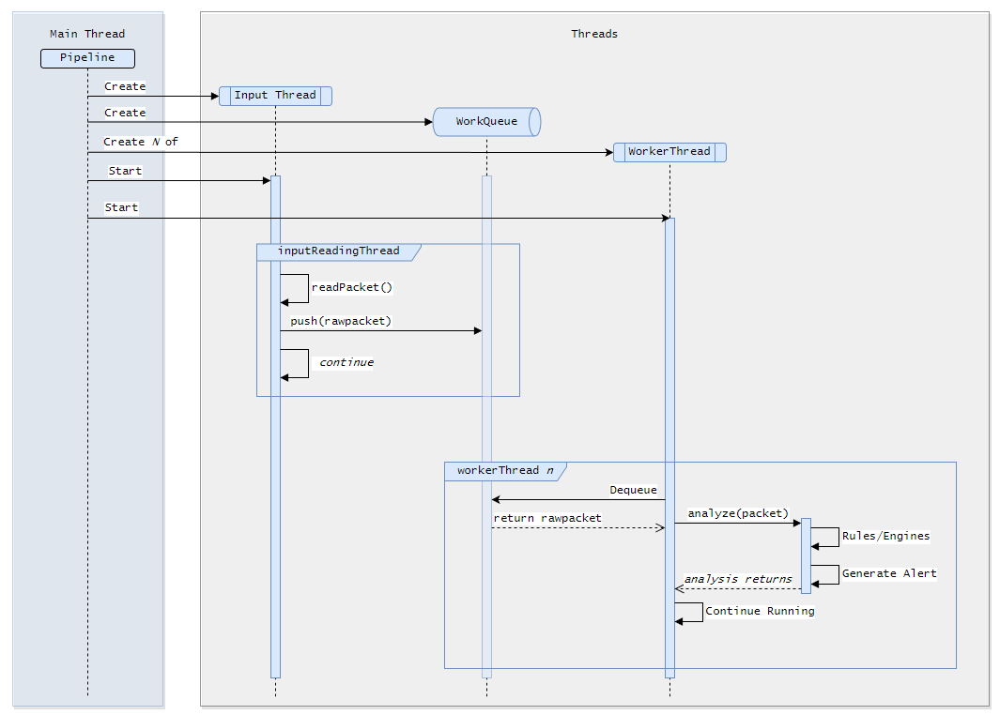
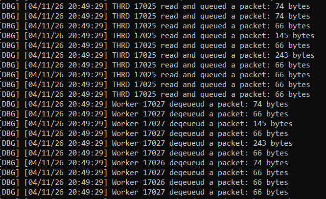

+++
date = '2026-04-06T09:50:42-04:00' 
draft = false
weight = 4
title = 'NIDS 03 - IO Sources and Multithreading'
+++
<br>
<div>
    <a class="link-button" href="../article-03">Prev</a>
    <a class="link-button" href="../">Article Home</a>
</div>
<br>

### Table of Contents
1. [Introduction](#introduction)
2. [Capture and Analysis Threads](#capture-and-analysis-threads)
3. [IO Sources](#io-sources)
    - [Network Adapter](#network-adapter)
    - [PCAP Files](#pcap-files)
4. [The Next Set of Articles](#the-next-set-of-articles)

### Introduction
One of the things that makes modern computers so fast is not just the minute silicon transistors, but multithreading. This is one area in particular where C++ shines...and where Vigil was grossly lacking. The goal then, of this feature, is to provide a way to capture on multiple interfaces and provide several worker threads for those interfaces to send work to. 

Furthermore, the previous design of this sensor was a bit lackluster. It contained a class called `CaptureSession` which controlled and coordinated everything. While this was useful for developing and testing other features like analyzers, it is no longer sufficient for the tasks at hand and particularly for multithreading. This article discusses an alternative design using IO Sources.

### Capture and Analysis Threads

After much self-debate, I decided to name the class that facilitates the reading of packets and running of the analysis pipeline, the `Pipeline` class. This is configured with a single IO Source and an 'entry point' analyzer. This would be the link type, for example, Ethernet. We could also develop an 802.11 decoder and use that as the entry point. While not necessarily within the scope of this article, I think it would be interesting to see if it is possible to detect deauthentication attacks. Later in this series, we will be tracking TCP conversations; I imagine the overall architecture would look similar.

This is an outline of the pipeline class:
```c++
class Pipeline
{
    Pipeline(Context& context);
    ~Pipeline();
    void setIOSource(std::shared_ptr<io_source::IOSource>&);
    void setLinkType(tag_t tag);
    void start();
private:
    void inputReadingThread(std::stop_token token);
    void workerThread(std::stop_token token);
private:
    std::shared_ptr<io_source::IOSource> m_ioSource;
    std::shared_ptr<Analyzer> m_entryProtocol;
    Context& m_context;

    std::mutex m_queueMtx;
    std::condition_variable m_newWorkCV;

    std::vector<std::jthread> m_workers;
    std::jthread m_inputThread;

    std::queue<io_source::RawPacket> m_workQueue;
};
```

As is evident, this is a pretty hefty class. This diagram illustrates how these threads are used:


The `Pipeline` creates one thread (`inputReadingThread`) that reads data from `m_ioSource`. It then locks the mutex (1), pushes the read data into `m_workQueue` (2), and finally notifies all waiting threads that there is data (3):

```c++

void Pipeline::inputReadingThread(std::stop_token token)
{
    while(!token.stop_requested())
    {
        // (1)
        RawPacket packet = m_ioSource->readPacket();

        if (packet.status == IOS_SUCCESS)
        {
            // (2)
            std::unique_lock lock {m_queueMtx};
            m_workQueue.push(std::move(packet));

            // (3)
            m_newWorkCV.notify_all();
        }
    }
}
```

The worker threads (`Pipeline::workerThread`) have more tasks:
1. Create a linear allocator - this is to be used by the `Packet` class.
2. Reset the allocator per iteration
3. Wait for data to arrive
4. Dequeue the data
5. Analyze it

```C++

void Pipeline::workerThread(std::stop_token token)
{
    // (1)
    auto allocator = std::make_shared<TrackedLinearAllocator>(PROTOCOL_ALLOC_SIZE);

    while(!token.stop_requested())
    {
        // (2)
        allocator->reset();

        std::unique_lock lock { m_queueMtx };
        // (3)
        m_newWorkCV.wait(lock, [this](){ return m_workQueue.size() > 0;});

        // (4)
        RawPacket rawpkt = std::move(m_workQueue.front());
        m_workQueue.pop();
        lock.unlock();

        // (5)
        Packet packet{&rawpkt.header, rawpkt.buffer.data(), allocator};
        m_entryProtocol->analyze(packet, packet.asRegion());
    }
}
```

Here is a screenshot of debug messages from the various threads where `THRD` is the input thread:


### IO Sources
As mentioned, previous versions used the inflexible `sensor::CaptureSession` class. It was highly monolithic and focused purely on network adapters. To allow for a wide range of inputs, I defined an interface called `IOSource`. This provides functions for reading and writing __packets__, not just any raw data:

```c++
enum IOStatus 
{
    IOS_SUCCESS,
    IOS_FAILURE
    ...
    ...
};
struct RawPacket
{
    pcap_pkthdr             header{};
    std::vector<uint8_t>    buffer{};
    IOStatus                status;
};
class IOSource
{
public:
    virtual ~IOSource() {};
    virtual bool isOpen() const = 0;
    virtual RawPacket readPacket() = 0;
    virtual size_t writePacket(const Packet& p) = 0;
};
```
Three IO Sources have been thus far defined: `NetworkAdapter`, `PCAPReader`, and `PCAPWriter`.

#### `NetworkAdapter`

This contains most of the functionality of `sensor::CaptureSession`. The biggest difference is that it no longer relies on `pcap_loop`. It performs this manually by calling `pcap_next_ex`:

```c++
RawPacket NetworkAdapter::readPacket()
{
    RawPacket result{};
    pcap_pkthdr* header = nullptr;
    const u_char* buffer = nullptr;
    int res = pcap_next_ex(
        m_handle, 
        &header,
        &buffer
    );

    if (!header || !buffer)
        return {IOS_NO_DATA};
    
    result.buffer.resize(header->caplen);
    
    std::memcpy(result.buffer.data(), buffer, header->caplen);
    std::memcpy(&result.header, header, sizeof(*header));

    switch (res)
    {
       // set error code...
    };
    return result;
}
```

#### PCAP Files
PCAP is a delightfully simple file format, unlike its sibling PCAPNG. It contains one global file header with information about timestamp formats and link types, then a per-packet header containing the timestamp and packet length:
```c++
constexpr uint32_t PCAP_HEADER_MAGIC_US     = 0xA1B2C3D4;
constexpr uint32_t PCAP_HEADER_MAGIC_NS     = 0xA1B23C4D;
constexpr uint16_t PCAP_VERSION_MJ          = PCAP_VERSION_MAJOR;
constexpr uint16_t PCAP_VERSION_MN          = PCAP_VERSION_MINOR;
constexpr uint32_t PCAP_SNAP_LEN            = 65535;
struct PCAPFileHeader
{
    uint32_t magic;
    uint16_t major;
    uint16_t minor;
    uint32_t res1;
    uint32_t res2;
    uint32_t snaplen;
    unsigned linktype: 28;
    unsigned fcs: 4;
};
struct PCAPPacketRecord
{
    uint32_t tsSeconds;
    uint32_t tsNanoOrMicroSeconds;
    uint32_t caplen;
    uint32_t originallen;
    // packet data
};
```

There are two PCAP IO Sources, one for reading and one for writing. I figure these should be mutually exclusive as it is highly unlikely that someone would both read and write to a single PCAP file. 

These two classes are fairly large so they are contained within collapsible sections:

<details>
    <summary><code>io_source::PCAPReader</code></summary>

```c++
PCAPReader::PCAPReader(const std::string& filename)
{
    m_input = std::ifstream{filename, std::ios::binary};
    if (!m_input.is_open())
        return;

    PCAPFileHeader header{};

    m_input.read(
        reinterpret_cast<char*>(&header), sizeof(header)
    );

    if (m_input.fail())
    {
        m_input.close();
        return;
    }
    // check timestamp type
    if (header.magic == PCAP_HEADER_MAGIC_NS)
        m_tstype = TimestampType::NANOSECONDS;
    else if (header.magic == PCAP_HEADER_MAGIC_US)
        m_tstype = TimestampType::MICROSECONDS;
    else 
    {
        SENSOR_DBG("Invalid PCAP file \"{}\", invalid header found (0x{:02x})", filename, header.magic);
        m_input.close();
        return;
    }
}
bool PCAPReader::isOpen() const
{
    return m_input.is_open();
}
RawPacket PCAPReader::readPacket()
{
    PCAPPacketRecord record{};
    m_input.read(
        reinterpret_cast<char*>(&record), sizeof(record)
    );

    if (m_input.eof())
        return {IOS_END_OF_DATA};
    if (!m_input.good())
        return {IOS_FAILURE};

    RawPacket result{};
    result.header.ts.tv_sec = record.tsSeconds;
    // convert if necessary
    if (m_tstype == TimestampType::NANOSECONDS)
        result.header.ts.tv_usec = record.tsNanoOrMicroSeconds / 1000;
    else 
        result.header.ts.tv_usec = record.tsNanoOrMicroSeconds;
    // copy the data
    result.header.caplen = record.caplen;
    result.header.len    = record.originallen;
    result.buffer.resize(record.caplen);

    m_input.read(
        reinterpret_cast<char*>(result.buffer.data()),
        record.caplen
    );

    if (m_input.eof())
        return {IOS_END_OF_DATA};
    if (!m_input.good())
        return {IOS_FAILURE};

    result.status = IOS_SUCCESS;

    return result;
}
```
</details>


<details>
    <summary><code>io_source::PCAPWriter</code></summary>

```c++
PCAPWriter::PCAPWriter(const std::string& filename)
{
    m_output = std::ofstream{filename, std::ios::binary};

    if (!m_output.is_open())
    {
        SENSOR_DBG("Failed to open file \"{}\" for writing", filename);
        return;
    }
    // libpcap uses us by default, so will we
    PCAPFileHeader header {
        .magic      = PCAP_HEADER_MAGIC_US,
        .major      = PCAP_VERSION_MJ,
        .minor      = PCAP_VERSION_MN,
        .snaplen    = PCAP_SNAP_LEN,
        .linktype   = DLT_EN10MB
    };

    m_output.write(
        reinterpret_cast<const char*>(&header),
        sizeof(header)
    );

    if (!m_output.good())
    {
        SENSOR_DBG("Failed to write PCAP Header...");
        m_output.close();
        return;
    }
}

RawPacket PCAPWriter::readPacket()
{
    return { IOS_NOT_IMPLEMENTED }; 
}

bool PCAPWriter::isOpen() const
{
    return m_output.is_open();
}

size_t PCAPWriter::writePacket(const Packet& packet)
{
    auto us = duration_cast<microseconds>(packet.getTimestampMicro()).count();
    auto ds = duration_cast<seconds>(packet.getTimestampSeconds()).count();
    PCAPPacketRecord record {
        .tsSeconds              = static_cast<uint32_t>(ds),
        .tsNanoOrMicroSeconds   = static_cast<uint32_t>(us),
        .caplen                 = static_cast<uint32_t>(packet.captureLength()),
        .originallen            = static_cast<uint32_t>(packet.length())
    };
    m_output.write(
        reinterpret_cast<const char*>(&record),
        sizeof(record)
    );

    m_output.write(
        reinterpret_cast<const char*>(packet.getRawPacket().data()),
        record.originallen
    );
    m_output.flush();

    return sizeof(record) + packet.captureLength();
}
```
</details>

### The Next Set of Articles
The first three articles of this series have covered primarily architectural concerns. We can now
1. Capture Packets from through a well defined interface
2. Analyze protocols and easily add new ones
3. Multithread said analysis
4. Efficiently manage memory used by analysis threads

Areas that are lacking include:
1. Command Line and File configuration
2. Hardcoded protocol mappings
3. Orchestration

These will be resolved hopefully in the next set of articles, which will include:
1. The Rule Language
2. Conversation and Flow Tracking
3. Heuristic Based Detection
4. Reporting

<br>
<div>
    <a class="link-button" href="../article-03">Prev</a>
    <a class="link-button" href="../">Article Home</a>
</div>
<br>