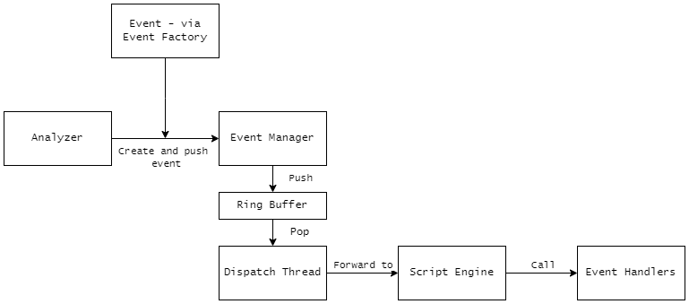
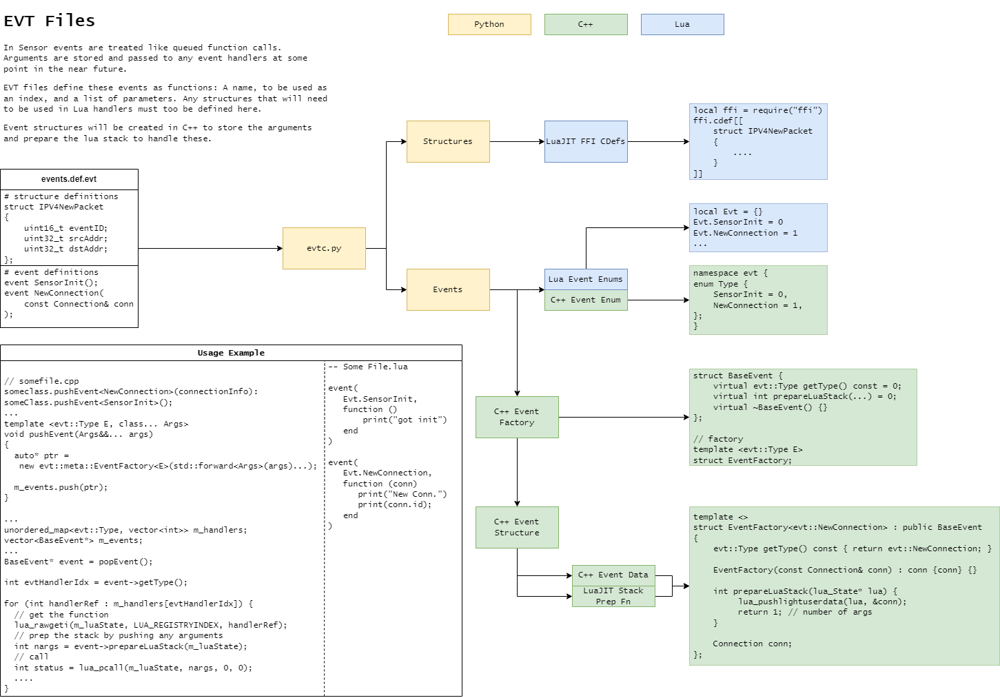
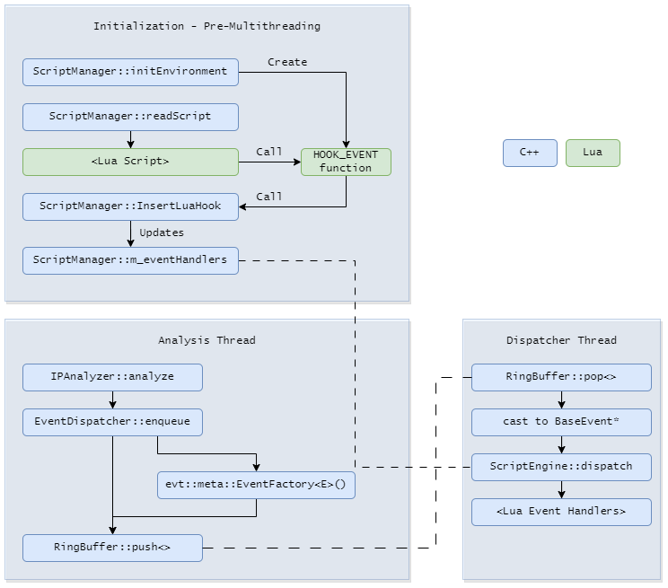

+++
date = '2026-06-22T09:44:37-04:00'
draft = true
weight = 5
title = 'NIDS 04 - Lua Integration'
+++
<br>
<div>
    <a class="link-button" href="../article-04">Prev</a>
    <a class="link-button" href="../">Article Home</a>
</div>
<br>

### Table of Contents
1. [Why Lua?](#why-lua)
2. [Event Handling Architecture](#event-handling-architecture)
3. [Event Compiler](#event-compiler)
4. [The Script Engine](#the-script-engine)
5. [Next Steps](#reflection-and-next-steps)
6. [I bestow upon thee...a name](#i-bestow-upon-theea-name)

### Introduction
An IDS isn't very useful if it cannot be configured and even less so if it relies on a static set of rules. Most IDSs provide a language with which an engineer can write these rules: Suricata uses a snort-like language; Snort also uses a snort-like language; Zeek/Bro has a custom event-based language, one of the inspirations for this project. While these custom DSLs are fascinating, they require a monumental engineering effort and a barrier to entry for analysis wishing to use the product.


### Why Lua?
I originally planned out a DSL, which while not completed will be the subject of an article in the near future. This DSL would be event-based, like Zeek, but more similar to Sigma or YARA rules. But I realized the effort it required on my part and that of the analyst's and decided to research alternatives. 

Python, I found, was a bit too slow for realtime detections. This is in part due to the Global Interpreter Lock, which according to the developers of CPython, [should be phased out in the next few years](https://peps.python.org/pep-0703/). And while I did not check, I imagine too it would be difficult to secure the Python environment——an attacker or perhaps a less than competent engineer could write a rule that interacts with the operating system directly, a massive security risk. However, Python does have it benefits. It is commonly used in reverse engineering tools to allow for plugins and more in-depth data analysis. An example of this would be in IDA Pro.

JavaScript was immediately out of the question, although I did wonder if it had a place in game development. It could, for example, be used in a UI system, one that might not be updated every frame, allowing ample time for JavaScript to run.

Lua, I found, had its place in nearly every type of tool in existence. In particular, I found a version of it called LuaJIT; this provides JIT as well as a Foreign Function Interface (FFI). I had integrated this into my previous project, although it was restricted for reporting only. After experiments, I came up with an idea for how it could be used for handling events.

### Event Handling Architecture

The overall flow of events would be as follows:
1. An analyzer retrieves a packet and creates an event; this event is placed in a queue owned by an event dispatcher.
2. The event dispatcher upon creation creates a dispatch thread whose sole responsibility is to pop events from the buffer and dispatch it.
3. When this happens, the dispatcher forwards the event to the script engine.
4. The script engine calls the appropriate Lua event handlers.




The idea is to replicate the structure of Zeek Script:
```ruby
module BlockList;
export {
    global ip_ban: set[subnet] = {
        <many ip addresses>
    };

}
event new_connection(c: connection)
{
    if (c$id$orig_h in ip_blocklist) {
        NOTICE([some alert message]);
    }
}
```
but within Lua:
```lua
local ffi = require("ffi")

local ip_ban = ...

hook_event(
    Evt.NewConnection,
    function (connection)
        if ip_ban[connection] then
            ffi.C.NOTICE("Connection in block list")
            ffi.C.drop_packet(connection)
        end
    end
)
```

Thus, the sensor will be an event-processing engine. An event will consist of an event ID and a list of arguments packed into a data structure that can be safely stored in memory indefinitely. Ideally, it will only persist for a short period of time, but even if the system is bogged down by massive loads of traffic with constantly changing internal states, those of individual events should be preserved.

Two things needed to happen to facilitate this in an efficient manner:
1. A Ring Buffer - this will the subject of one of the upcoming articles
2. A framework through which events can be created

#### Event Factories
For the latter there were several considerations in mind, primarily, how to make as simple as possible the method by which events are created and enqueued. This is solved in conjunction with the next issues: how to identify event types without using RTTI. The solution I came up with was a sort of "templated event factory."

All of the code relating to event factories an the like have been placed in the `evt` namespace. Event factories themselves and any extra data are in `evt::meta`. This is so when a developer is creating events, they can type "evt::" and see all valid event types they could possibly create without the clutter of extra data such as specializations or event data.

To start with, there is an enumeration of all valid event types:
```c++
enum Type
{
    SensorInit = 0,
    NewConnection = 1,
    NewIPV4Packet = 2
};
```

Next, there is a `BaseEvent` class to facilitate interactions with different event types:

```c++
struct BaseEvent
{
    virtual evt::Type getType() const = 0;
    virtual int prepareLuaStack(lua_State*) = 0;
    virtual ~BaseEvent() = 0;
}
```

The `BaseEvent::prepareLuaStack` function will be discussed in the next section.

Finally we have an event factory:

```C++
template <evt::Type T>
struct EventFactory;
```

To actually use the event factory, we define template specializations that all derive from `BaseEvent`. These will contain any arguments that should be passed to the event handlers:

```c++
template <>
struct EventFactory<evt::SensorInit> : public BaseEvent
{
    evt::Type getType() const { return evt::Type::SensorInit; }
    int prepareLuaStack(lua_State* lua) { return 0; }
    // no data
};

template <>
struct EventFactory<evt::NewConnection> : public BaseEvent
{
    evt::Type getType() const { return evt::Type::NewConnection; }

    int prepareLuaStack(lua_State* lua)
    {
    	lua_pushlightuserdata(lua, (void*)&c);
        return 1;
    }
    EventFactory(const Connection& c) :  c {c} {}
    Connection c;
};
```

While the event dispatcher will not be the subject of this article, this particular function of it will be: the event enqueueing function:

```c++

template <evt::Type E, class... Args>
void EventDispatcher::enqueue(Args&&... args)
{
    auto event = evt::meta::EventFactory<E>(std::forward<Args>(args)...);

    ... push into queue ...
}
```

This makes creating events extremely easy:

```c++
// ipv4 analyzer perhaps

...
eventMgr.enqueue<evt::NewConnection>(Connection{.key=value,...});
...

```
### Event Compiler

There are two remaining issues with this system:
1. Creating events is very cumbersome. The potential for Lovecraftian template errors is nausea inducing.
2. Lua still needs to be considered. This is a two part issue:
    - C struct definitions for event data needs to be relayed to LuaJIT's FFI system somehow - this could introduce code duplication if not done carefully
    - Data needs to be pushed onto the Lua stack at runtime. It would be very unpleasant if a developer had to pore over the Lua documentation or even a knowledge-base article to push stuff onto the stack. This could be solved with RTTI, but that would be slow.

A solution I came up with is an event compiler. This takes event definitions, *including* definitions for the events' arguments, if necessary. The compiler ingests an event definition file at compile time and generates a two C++ headers: one containing the event factory definitions, including functions to prepare the Lua stack, and another containing a static lua script with its FFI/event definitions.

I chose Python to do this because its string manipulation is much more powerful and much simpler than C++'s - although, C++ is getting much better with this following the standardization of the new(ish) format library.

The event definition file looks like this:
```c    
# structures
struct Connection
{
    uint32_t srcAddr;
    uint32_t dstAddr;
    uint16_t srcPort;
    uint16_t dstPort;
};

struct IPV4NewPacket
{
    uint16_t eventID;
    uint32_t srcAddr;
    uint32_t dstAddr;

};

# event definitions
event SensorInit();
event NewConnection(const Connection& conn);
event NewIPV4Packet(const IPV4NewPacket& packet);
```

This language is simple enough to be parsed entirely using regex. While I will not detail the entire source code of the compiler, albeit small, I will present a diagram of how it works, then a collapsible section containing the entire source code for those curious.

This is the diagram:


And here is the collapsible section:
<details>
<summary><code>evtc.py</code></summary>

```python
import argparse
import re
from typing import Dict, List, Tuple
from dataclasses import dataclass

from lua_mapping import CPP_TO_LUA

STRUCT_PATTERN = r'(struct\s+(\w+)\s*\{.*?\};)'
EVENT_PATTERN = r'event\s+(\w+)\s*\((.*?)\)\s*;'
ARGUMENT_PATTERN = r'\b(const\s+)?([a-zA-Z_]\w*)\s*([\*&]*)\s*([a-zA-Z_]\w*)\b'

@dataclass
class EventParameter:
    name: str
    type: str
    is_pointer: bool    = False
    is_reference: bool  = False

@dataclass
class EventMeta:
    argument_str: str
    argument_list: List[EventParameter]
    eid: int

StructDefs = Dict[str, str]
EventDefs = Dict[str, EventMeta]

class CPPTranslator:
    
    def __init__(self, structs: StructDefs, events: EventDefs):
        self._structs = structs
        self._events = events

        self._output = """
#ifndef ____EVT_CMP_GEN_H____
#define ____EVT_CMP_GEN_H____

#include <inttypes.h>

#ifndef LUA_VERSION
#   error "Lua must be included before this file"
#endif // LUA_VERSION

namespace evt
{

enum Type
{
%s
};

namespace meta
{

%s

struct BaseEvent
{
    virtual evt::Type getType() const = 0;
    virtual int prepareLuaStack(lua_State*) = 0;
    virtual ~BaseEvent() {}
};

template <evt::Type T>
struct EventFactory;

%s

} // namespace meta

} // namespace evt

#endif // ____EVT_CMP_GEN_H____
"""

    def translate(self) -> str:
        
        enum_source = ""
        factory_source = ""

        structs = ""

        for v in self._structs.values():
            structs += f"{v}\n"

        for k, v in self._events.items():
            enum_source += f"\t{k} = {v.eid},\n"
            factory_source += self._create_factory(k, v)
        return self._output % (enum_source, structs, factory_source)


    def _create_factory(self, name: str, event: EventMeta):
        constructor = ""
        if len(event.argument_list) > 0:
            local_vars = ""
            init_list = ""

            for arg in event.argument_list:

                local_vars += f"    {'const ' if arg.is_pointer else ''}{arg.type}{'*' if arg.is_pointer else ""} {arg.name};\n"
                init_list += f" {arg.name} {{{arg.name}}},"
            
            init_list = init_list.removesuffix(',')
        #### CONSTRUCTOR ####
            constructor = f"""
    EventFactory({event.argument_str}) : {init_list} {{}}

{local_vars}
"""
        #### LUA STACK FUNCTION ####
        lua_stack_function = self._create_lua_stack_function(event.argument_list)

        #### ACTUAL SOURCE CODE ####
        source = f"""
/* event {name}({event.argument_str}) */
template <>
struct EventFactory<evt::{name}> : public BaseEvent
{{
    evt::Type getType() const {{ return evt::Type::{name}; }}

{lua_stack_function}

    {constructor}
}};\n
"""
        return source

    def _create_lua_stack_function(self, params: List[EventParameter]):
        
        
        stack_fn_body = ""
        for param in params:

            fn = ""
            is_struct = False
            if param.is_pointer and param.type == "char":
                fn = "lua_pushstring"
            else:
                fn = CPP_TO_LUA.get(param.type)

                if fn is None:
                    is_struct = True
                    fn = "lua_pushlightuserdata"
            
            stack_fn_body += f"\t{fn}(lua, {'(void*)&' if is_struct else ''}{param.name});\n"

        
        stack_function = f"""
    int prepareLuaStack(lua_State* lua)
    {{
    {stack_fn_body}
        return {len(params)};
    }}
"""
        return stack_function
            

class LuaTranslator:
    
    def __init__(self, structs: StructDefs, events: EventDefs):

        self._structs = structs
        self._events = events

        self._output = """
#ifndef ____EVENTS_LUA_HPP____
#define ____EVENTS_LUA_HPP____

#include <string_view>

namespace evt
{

constexpr std::string_view SENSOR_LUA_SOURCE = R"lua(
local ffi = require("ffi")

ffi.cdef[[
    %s
]]

%s

)lua";

} // namespace evt

#endif // ____EVENTS_LUA_HPP____
"""

    def translate(self) -> str:
        
        cdef_source = ''

        for v in self._structs.values():
            cdef_source += f"{v}\n"

        ids = self._write_event_ids()

        return self._output % (cdef_source, ids)
    
    def _write_event_ids(self):
        
        source = ""

        for k, v in self._events.items():

            source += f"Evt.{k} = {v.eid}\n"

        return source

class Parser:

    def __init__(self, path: str):

        self._structs: StructDefs = {}

        # event name => event arguments
        self._events: EventDefs = {}

        self._id_counter = 0 

        self._source = ""

        with open(path) as file:
            self._source = file.read()

        self._lua_output = ""
        self._cpp_output = ""

    def get_lua_output(self):
        return self._lua_output
    
    def get_cpp_output(self):
        return self._cpp_output
    
    def run(self):
        
        self._extract_events_and_structs()

        luat = LuaTranslator(self._structs, self._events)
        cppt = CPPTranslator(self._structs, self._events)

        self._lua_output = luat.translate()
        self._cpp_output = cppt.translate()

    def _extract_events_and_structs(self):
        
        struct_rgx  = re.compile(STRUCT_PATTERN, re.DOTALL)
        event_rgx   = re.compile(EVENT_PATTERN)
        arg_rgx     = re.compile(ARGUMENT_PATTERN)

        for match in struct_rgx.finditer(self._source):

            struct = match.group(1)
            name = match.group(2)

            self._structs[name] = struct

        for match in event_rgx.finditer(self._source):

            arguments = match.group(2)
            name = match.group(1)
            argument_list = arg_rgx.findall(arguments)
            params = []
            for i in argument_list:
                _, type_, ptr_ref, name_ = i

                params.append(EventParameter(
                    name=name_,
                    type=type_,
                    is_pointer=ptr_ref == '*',
                    is_reference=ptr_ref == '&'
                ))

            self._events[name] = EventMeta(
                argument_str=arguments,
                argument_list=params,
                eid=self._id_counter
            )

            self._id_counter += 1

if __name__ == '__main__':

    ap = argparse.ArgumentParser()
    ap.add_argument('-f', help="Input file", required=True)
    ap.add_argument('-o', help="Output file prefix", required=True)

    args = ap.parse_args()
    parser = Parser(args.f)

    parser.run()

    with open(f"{args.o}.lua.hpp", "w") as lua_output:
        lua_output.write(parser.get_lua_output())

    with open(f"{args.o}.hpp", "w") as cpp_output:
        cpp_output.write(parser.get_cpp_output())
```
</details>

#### CMake Integration
The final step is to integrate this into the build system, which was far less painful than I had anticipated:

```CMake
find_package(Python3 REQUIRED COMPONENTS Interpreter)

set(EVTC_SCRIPT_LOCATION    "${CMAKE_SOURCE_DIR}/evtc/evtc.py")
set(EVTC_EVENT_DEFS         "${CMAKE_SOURCE_DIR}/sensor/event/Events.def.evt")
set(EVTC_OUTPUT_PREFIX      "${CMAKE_SOURCE_DIR}/sensor/event/events.gen")
set(EVTC_OUTPUT_CPP         "${CMAKE_SOURCE_DIR}/sensor/event/events.gen.hpp")
set(EVTC_OUTPUT_LUA         "${CMAKE_SOURCE_DIR}/sensor/event/events.gen.lua.hpp")

add_custom_command(
    OUTPUT ${EVTC_OUTPUT_CPP} ${EVTC_OUTPUT_LUA}
    COMMAND Python3::Interpreter ${EVTC_SCRIPT_LOCATION} -f ${EVTC_EVENT_DEFS} -o ${EVTC_OUTPUT_PREFIX}
    DEPENDS ${EVTC_EVENT_DEFS} ${EVTC_SCRIPT_LOCATION}
    COMMENT "Generating Event Definitions from ${EVTC_EVENT_DEFS}"
)
```

### The Script Engine
The last component is the scripting engine. This manages the Lua state, sets up the execution environment, ingests scripts, and dispatches events. 

This is the outline of the class:

```c++

using LuaRef = int;

class ScriptEngine
{
public:
    ScriptEngine();
    ~ScriptEngine();
    
    int readScript(const std::string& path);
    
    static int LuaEventHook(lua_State* lua);
    
    void dispatch(evt::meta::BaseEvent& event);
private:
    
    void insertLuaEventHook(uint32_t eventID, LuaRef refID);
    
    void initEnvironment();

private:

    lua_State* m_luaState;
    
    std::unordered_map<
        uint32_t,
        std::vector<LuaRef>
    > m_eventHandlers;
};
```

When this class is initialized, it calls the `initEnvironment` function. This sets up a Lua state, creates pseudo namespace for event IDs, registers a function through which events can be hooked, and finally, it executes that static Lua script mentioned in the previous section:

```c++
void ScriptEngine::initEnvironment()
{
    m_luaState = luaL_newstate();

    if (!m_luaState)
        throw std::bad_alloc();

    luaL_openlibs(m_luaState);

    lua_pushlightuserdata(m_luaState, this);
    lua_setglobal(m_luaState, SCRIPT_ENGINE_CONST_NAME);
    /// event hooking function
    lua_register(m_luaState, "HOOK_EVENT", ScriptEngine::LuaEventHook);

    /// Evt table
    lua_newtable(m_luaState);
    lua_setglobal(m_luaState, "Evt");

    /// Load the main lua script w/ cdefs and enum
    int res = luaL_dostring(m_luaState, evt::SENSOR_LUA_SOURCE.data());

    if (res != LUA_OK)
    {
        throw std::logic_error(
            std::format(
                "Failed to load internal lua script (evt::SENSOR_LUA_SOURCE): {}", 
                lua_tostring(m_luaState, -1)
            )
        );
    }
}
```

Next we have the function the allows hooking. Notice that within the `initEnvironment` function, we create a global internal variable by the name of `SCRIPT_ENGINE_CONST_NAME`. That is a reference to `this`; in the initial hook function, we can extract this, cast it back to a `ScriptEngine*`, then call the internal hook function:

```c++

int ScriptEngine::LuaEventHook(lua_State* lua)
{
    uint32_t eventID = static_cast<uint32_t>(luaL_checkinteger(lua, 1));

    luaL_checktype(lua, 2, LUA_TFUNCTION);
    lua_pushvalue(lua, 2);

    LuaRef ref = luaL_ref(lua, LUA_REGISTRYINDEX);

    lua_getglobal(lua, SCRIPT_ENGINE_CONST_NAME);

    auto* scriptengine = static_cast<ScriptEngine*>(lua_touserdata(lua, -1));

    scriptengine->insertLuaEventHook(eventID, ref);

    lua_pop(lua, 1);

    return 0;
}

void ScriptEngine::insertLuaEventHook(uint32_t eventID, LuaRef refID)
{
    SENSOR_DBG("Loaded Lua Event Handler {} for event ID {:02x}", refID, eventID);
    m_eventHandlers[eventID].push_back(refID);
}
```

Finally, we have the dispatch function:
```c++
void ScriptEngine::dispatch(evt::meta::BaseEvent& event)
{
    auto eventID = event.getType();

    if (m_eventHandlers.contains(eventID))
    {
        for (LuaRef ref : m_eventHandlers[eventID])
        {
            lua_rawgeti(m_luaState, LUA_REGISTRYINDEX, ref);

            int args = event.prepareLuaStack(m_luaState);

            int status = lua_pcall(m_luaState, args, 0, 0);

            if (status != LUA_OK)
            {
                SENSOR_DBG("Execution of callback #{} failed: {}", ref, lua_tostring(m_luaState, -1));
                lua_pop(m_luaState, 1);
            }
        }

    }
}
```

This diagram details how the script engine is initialized and then is used in the multithreaded event system:



### Reflection and Next Steps

This article discussed the implementation of a Lua-centric event system into the IDS. With this system, developers can easily define and create events while analysts can easily learn how to hook them.

This article also discussed briefly multithreading, in particular, ring buffers. This will be the subject of a near-future article.

Some next steps include:
- Expound on the multithreaded analysis system, likely integrating a SPMC system for IO source <=> Analysis Threads
- Multithreaded Logging - right now performance cannot be accurately gauged because logs are formatted and printed on any arbitrary thread
- More utility functions for Lua scripts
- C++ event handlers
- Reporting
- More advanced security features like SPI, conversation tracking, file extraction, etc.

Some random tasks might include 
- Adding protocol map support to the EVT compiler. Right now it is a handwritten association
- Profiling, lots of profiling
- Auto-casting for Lua FFI definitions
- Probably some sort of more advanced pipeline system

### I bestow upon thee...a name
After a few months of namelessness, I decided to name the sensor Theia after the Greek Titaness of sight. This is much more memorable than sensor. Now I just have to rename all of the namespaces...

<br>
<div>
    <a class="link-button" href="../article-04">Prev</a>
    <a class="link-button" href="../">Article Home</a>
</div>
<br>